<div align="center">


<a href="https://linkedin.com/in/varunghorpade"></a>
<a href="mailto:vghorpad@usc.edu"></a>


</div>

```diff
+ POST complete. All systems nominal. Loading profile...
```

I've been building PCs since **Class 10**: picking parts, checking compatibility, routing cables, and the moment it powers on for the first time. I build software and careers the same way.

My **foundation** is a B.E. in IT from the University of Mumbai (9.37 CGPA). On top of that I installed **3.5+ years at KPMG**, where I went from ETL intern to Consultant, running Basel III platforms over 50TB+ of data and building HA/DR deployments for 4 banks. **In Aug 2026** I upgraded the CPU: an **M.S. in Computer Science at USC Viterbi**. These days the GPU runs **agentic AI**: hackathon platforms, campus agent networks, and tools for real small businesses.

This page is my rig. Open it up. 👇

<br/>

## 🖥️ The build

<div align="center">
</div>

<details>
<summary><b>🔧 Take the side panel off: inspect each component</b> <sub>(click)</sub></summary>
<br/>

<details>
<summary>🧠 <b>CPU</b>: M.S. Computer Science · USC Viterbi</summary>

> **Aug 2026 – May 2028** · Los Angeles
> Coursework: Analysis of Algorithms (CSCI 570) · Database Systems (CSCI 585)
> The upgrade that started this whole new build.
</details>

<details>
<summary>💾 <b>RAM · 4×DIMM</b>: 3.5+ years @ KPMG India</summary>

> Four sticks, one per role: **Intern (Jan '23) → Analyst (Jun '23) → Associate Consultant (Mar '25) → Consultant (Mar '26)**.
> The full spec sheet is in the [Memory](#-memory-kpmg-india) section below.
</details>

<details>
<summary>🎮 <b>GPU</b>: Agentic AI</summary>

> LangGraph multi-agent workflows, XGBoost + GATv2 GNN ensembles, and LLM output checked by verifiers before anything ships.
> Running right now: **TraceLayer** (AML investigation) and **TrojanConnect** (USC campus agent network).
</details>

<details>
<summary>🧩 <b>Motherboard</b>: B.E. Information Technology · Univ. of Mumbai</summary>

> **Jul 2019 – May 2023** · **CGPA 9.37 / 10**
> Data Structures · Operating Systems · Computer Networks · Cloud Computing · Infrastructure Security
</details>

<details>
<summary>⚡ <b>NVMe SSD</b>: Indian Patent App. #202220149857</summary>

> **SkyCrewClub**, a decentralized learning platform. Polygon smart contracts issue NFT credentials, cutting verification from **7 days to real time** for **100+ users**.
</details>

<details>
<summary>🔌 <b>PSU</b>: Founder Mode</summary>

> **The Whole Nine Yards (TWNY)**, my fashion brand; I write its ops software myself.
> **Covero Essentials**, a face-mask business I started during COVID-19.
</details>

<details>
<summary>❄️ <b>Cooling</b>: Chairperson, RAIT ACM Student Chapter</summary>

> Led the **RAIT ACM Student Chapter** and its **30–40 person core team**, running a steady stream of **technical and non-technical events**: **30+ events and hackathons for 500+ people**.
> Took the chapter into the **Top 10 Best ACM Chapters in India** (of 250+), and grew membership **108% (120 → 250)**.
> Also Technology & Digital Transformation Lead at **Dhanwantari Medical Trust** for 12+ free healthcare camps.
</details>

<details>
<summary>🌐 <b>NIC</b>: USC ITS, Learning Environments</summary>

> **Technical Student Worker · Aug 2026 – present**
> Level 2 support for classroom IT and AV at **99.9% availability** for live lectures · Bash/Python diagnostics that cut manual checks by **25%**.
</details>

</details>

<br/>

## ⚙️ Running processes

<div align="center">
</div>

<br/>

<div align="center">

<a href="https://github.com/MallankG/TrojanHacks2026"></a>
<a href="https://github.com/MallankG/TrojanConnect"></a>
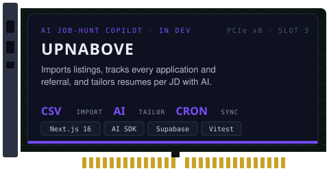
<a href="https://github.com/veerefines/SkyCrewClub"></a>
<a href="https://github.com/varad615/Fabrink">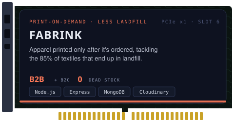</a>
<a href="https://github.com/veerefines/AmbiLights"></a>

<sub>🖱️ Every expansion card plugs into its repo. UpNAbove, TumbleDry and TWNY are private business code.</sub>

</div>

<br/>

## 🧾 Build log

<div align="center">
</div>

<br/>

## 💾 Memory: KPMG India

<div align="center">
</div>

<details>
<summary><b>📋 Read the SPD chip: the full spec sheet</b></summary>
<br/>

| DIMM | Role | Dates | Specs |
|:-:|---|---|---|
| **4** | **Software Engineer, Infrastructure** · *Consultant* | Mar 2026 – Aug 2026 | Multi-node **HA deployments with active-passive DC-DR** on RHEL 8.6 for **4 major banks**, with **Kubernetes** running WebLogic and Tomcat · **CI/CD in Go and Python** to provision OFSAA: **releases 30% faster**, zero-downtime upgrades |
| **3** | **Software Engineer, Infrastructure** · *Associate Consultant* | Mar 2025 – Mar 2026 | Batch pipelines over **50TB+ of regulatory data** made **40% faster** through JVM tuning, Linux kernel parameters and PL/SQL rewrites · Bash/cron automation for scheduling, restarts and log aggregation · Deployed OFSAA, ODI 12c and OBIEE/OAS stacks · Wrote Basel III solution designs |
| **2** | **Data Engineer, OFSAA & SQL** · *Analyst* | Jun 2023 – Mar 2025 | Led the **OFSAA Basel Credit Risk migration (v8.0.2 → v8.1.2)** with minimal downtime · Built **PL/SQL reconciliation engines** checking UAT against production for **100% data integrity** |
| **1** | **ETL Developer Intern** | Jan 2023 – Jun 2023 | Normalized **Erwin 15.1** data models · Validated high-throughput **ODI 12c** ETL pipelines for credit-risk data |

🏆 **Super Employee** · **Impact Award** · **Kudos Award** (2025–26)

</details>

<br/>

## 📈 Benchmarks

<div align="center">
</div>

<br/>

## 🧩 Part list

<div align="center">
</div>

<br/>

## 📡 Sensors

<div align="center">


</div>

<details>
<summary><b>⌨️ Press DEL to enter BIOS setup</b> <sub>(hidden settings)</sub></summary>
<br/>

```ini
[Boot Order]
1 = Curiosity
2 = Ship it
3 = Make it pretty

[Overclocking]
Hackathon Mode      = Enabled      ; TrojanHacks 2026 → TraceLayer
Weekend Builds      = Enabled      ; TumbleDry, TWNY IMS, UpNAbove
RGB                 = Synced       ; see AmbiLights

[Side Quests]
Fashion             = The Whole Nine Yards
Pandemic Startup    = Covero Essentials
Community           = Dhanwantari Medical Trust · 12+ free health camps
Trip Planning       = Built a website for it (Rishikesh 2026)

[Hobby]
PC Building         = since Class 10 · never stopped
```

</details>

<br/>

<div align="center">

<a href="mailto:vghorpad@usc.edu"></a>

<sub>Every panel here is a hand-built animated SVG. No templates were harmed. ⚡</sub>

</div>
