

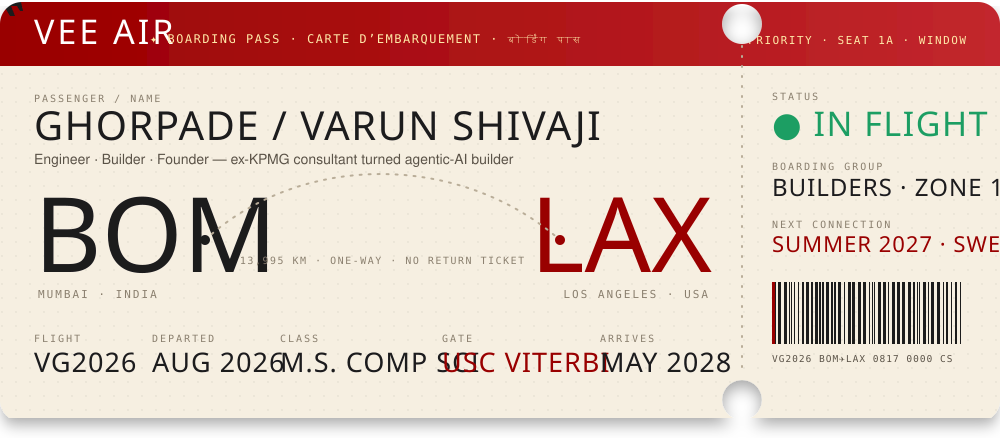


 

> **Ladies and gentlemen, welcome aboard.**
>
> I spent **3.5+ years at KPMG** keeping the regulatory engines of banks running: Basel III pipelines, Oracle OFSAA platforms, and the Linux servers underneath them. I went from ETL intern to Consultant, promoted ahead of cycle.
>
> Then I bought a one-way ticket from Mumbai to LA. I'm now doing my **M.S. in Computer Science at USC Viterbi**, working at **USC ITS**, and building **AI agents that still behave when real people use them**.
>
> Along the way I've started businesses, filed a patent, and run one of India's top 10 ACM chapters. Please keep your seatbelt loosely fastened. We ship fast around here.

 

## ✈️ Departures


 

<a href="https://github.com/MallankG/TrojanConnect">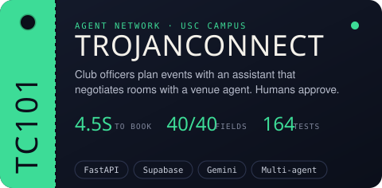</a>
<a href="https://github.com/MallankG/TrojanHacks2026">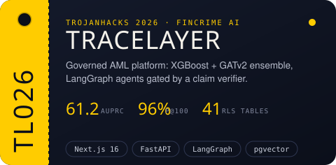</a>
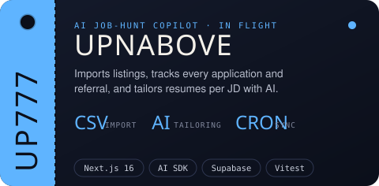
<a href="https://github.com/veerefines/saani-atelier">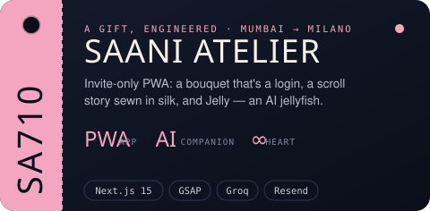</a>
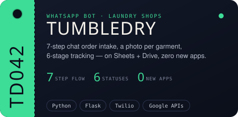
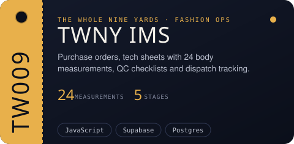
<a href="https://github.com/veerefines/SkyCrewClub">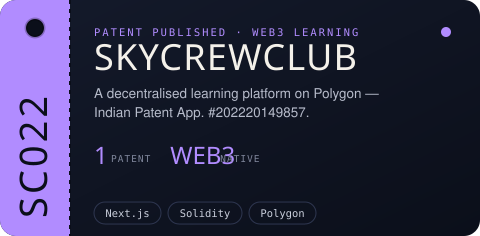</a>
<a href="https://github.com/varad615/Fabrink">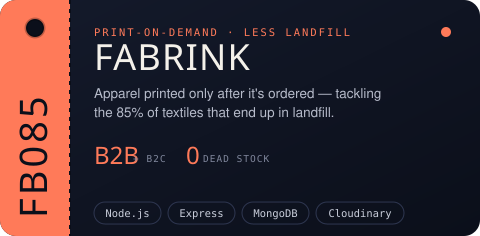</a>

🎫 Click a tag to open its repo. UpNAbove, TumbleDry and TWNY are private: they're client and business code.

 

## 🗺️ Flight log: how I got here


 

## 🎖️ Previous carrier


<b>📼 Open the black box: what I actually did at KPMG</b>

 

| | |
|---|---|
| 🏛️ **Regulatory platforms** | Built and ran **Oracle OFSAA** environments that power **Basel III** reporting for banking clients |
| 🔄 **Data pipelines** | Designed ETL in **Oracle Data Integrator** and wrote production **SQL / PL-SQL** for risk and finance data |
| 📊 **Reporting** | Delivered dashboards and regulatory reports on **OBIEE / Oracle Analytics Server** |
| 🖥️ **Infrastructure** | Owned **RHEL** servers and **WebLogic / Tomcat** app servers: environment builds, upgrades, keeping them up |
| 🏆 **Recognition** | **Super Employee 2026** · **Impact Award 2026** · **Kudos Award 2025** · promoted to Consultant **ahead of cycle** |

 

## 🛂 Passport stamps


 

## 🧳 Baggage claim: what I packed


 

## 🛍️ Duty-free: side quests

- 👔 **The Whole Nine Yards (TWNY)**: my fashion brand. I write its ops software myself, from purchase orders to QC.
- 😷 **Covero Essentials**: the face-mask company I started during COVID-19. It's where I learned supply chains under pressure.
- 🏥 **Dhanwantari Medical Trust**: Technology & Digital Transformation Lead for **12+ free healthcare camps**.
- 💡 **[AmbiLights](https://github.com/veerefines/AmbiLights)**: LEDs behind my monitor that match the colours at the screen's edges.
- 🏔️ **[Rishikesh 2026](https://github.com/veerefines/Rishikesh2026)**: I plan group trips the only way I know how: by building them a website.

 

## 📡 In-flight telemetry

 

<a href="mailto:vghorpad@usc.edu">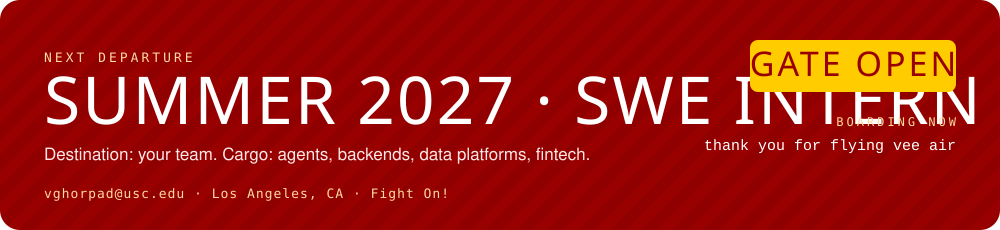</a>

All the visuals here are hand-built animated SVGs, with no templates. ✌️ Fight On.

